# ER Model

*Report chapter 3.* Source of truth: [`database/01_schema.sql`](../database/01_schema.sql) and
[`database/02_constraints_indexes.sql`](../database/02_constraints_indexes.sql).

## Entities and relationships

| # | Entity | Kind | Key |
| --- | --- | --- | --- |
| 1 | User | strong | user_id |
| 2 | Role | strong (lookup) | role_id |
| 3 | Permission | strong (lookup) | permission_id |
| 4 | Universe | strong | universe_id |
| 5 | Title | strong | title_id |
| 6 | Genre | strong (lookup) | genre_id |
| 7 | Character | strong | character_id |
| 8 | RelationshipType | strong (lookup) | relationship_type_id |
| 9 | StoryEvent | strong, existence-dependent on Title | event_id |
| 10 | CharacterArc | strong, existence-dependent on Character and Title | arc_id |
| 11 | Review, Bookmark, WatchProgress | strong (surrogate keys) | review_id, bookmark_id, progress_id |
| 12 | AuditLog | strong | audit_id |

| Relationship | Between | Cardinality | Participation | Attributes | Table |
| --- | --- | --- | --- | --- | --- |
| HAS ROLE | User – Role | M:N | User total (≥ Viewer) | assigned_at | `user_roles` |
| GRANTS | Role – Permission | M:N | partial | — | `role_permissions` |
| CONTAINS | Universe – Title | 1:N | Title partial (standalone allowed) | — | FK `titles.universe_id` (nullable) |
| CLASSIFIED AS | Title – Genre | M:N | partial | — | `title_genres` |
| BELONGS TO | Universe – Character | 1:N | Character partial | — | FK `characters.universe_id` (nullable) |
| APPEARS IN | Character – Title | M:N | partial | character_role, appearance_notes | `character_appearances` |
| RELATES TO (directed, recursive) | Character – Character | M:N | partial | type, description | `character_relationships` |
| OF TYPE | CharacterRelationship – RelationshipType | N:1 | total | — | FK |
| HAS EVENT | Title – StoryEvent | 1:N | StoryEvent total | — | FK `story_events.title_id` NOT NULL |
| PARTICIPATES IN | Character – StoryEvent | M:N | partial | participation_type, involvement_description, outcome | `event_participants` |
| HAS ARC | Character – CharacterArc | 1:N | Arc total | — | FK NOT NULL |
| ARC IN | Title – CharacterArc | 1:N | Arc total | — | FK NOT NULL |
| DEVELOPED THROUGH | CharacterArc – StoryEvent | M:N | partial | sequence_number, development_note | `arc_events` |
| BOOKMARKS | User – (Title **xor** Character) | 1:N | partial | created_at | `bookmarks` |
| REVIEWS | User – Title | M:N, at most one per pair | partial | rating, review_text | `reviews` |
| TRACKS | User – Title | M:N, at most one per pair | partial | status, percentage | `watch_progress` |
| PERFORMED | User – AuditLog | 1:N | AuditLog partial (NULL = system) | — | FK `audit_logs.user_id` |

## ER diagram (Mermaid)

Crow's-foot notation: `||` exactly one, `o|` zero or one, `|{` one or many, `o{` zero or many.

```mermaid
erDiagram
    users ||--o{ user_roles : "has"
    roles ||--o{ user_roles : "assigned in"
    roles ||--o{ role_permissions : "grants"
    permissions ||--o{ role_permissions : "granted by"
    users |o--o{ audit_logs : "performed"

    universes |o--o{ titles : "contains"
    universes |o--o{ characters : "home of"
    titles ||--o{ title_genres : "classified"
    genres ||--o{ title_genres : "classifies"

    characters ||--o{ character_appearances : "appears"
    titles ||--o{ character_appearances : "features"
    characters ||--o{ character_relationships : "source of"
    characters ||--o{ character_relationships : "target of"
    relationship_types ||--o{ character_relationships : "types"

    titles ||--o{ story_events : "has"
    story_events ||--o{ event_participants : "involves"
    characters ||--o{ event_participants : "takes part"
    characters ||--o{ character_arcs : "develops"
    titles ||--o{ character_arcs : "hosts"
    character_arcs ||--o{ arc_events : "step"
    story_events ||--o{ arc_events : "marks"

    users ||--o{ bookmarks : "saves"
    titles |o--o{ bookmarks : "bookmarked"
    characters |o--o{ bookmarks : "bookmarked"
    users ||--o{ reviews : "writes"
    titles ||--o{ reviews : "receives"
    users ||--o{ watch_progress : "tracks"
    titles ||--o{ watch_progress : "tracked"

    users {
        int user_id PK
        varchar username UK
        varchar email UK
        text password_hash
        varchar account_status
        timestamptz created_at
    }
    roles {
        int role_id PK
        varchar role_name UK
        text description
    }
    permissions {
        int permission_id PK
        varchar permission_code UK
        text description
    }
    user_roles {
        int user_id PK,FK
        int role_id PK,FK
        timestamptz assigned_at
    }
    role_permissions {
        int role_id PK,FK
        int permission_id PK,FK
    }
    audit_logs {
        bigint audit_id PK
        int user_id FK "nullable = system"
        varchar action
        varchar entity_type
        text entity_id "polymorphic, no FK"
        jsonb old_data
        jsonb new_data
        timestamptz created_at
    }
    universes {
        int universe_id PK
        varchar name UK
        text description
        varchar origin_type
        text cover_image_url
        timestamptz created_at
    }
    titles {
        int title_id PK
        int universe_id FK "nullable"
        varchar name
        varchar media_type
        text synopsis
        date release_date
        varchar status
        text poster_url
        text banner_url
        timestamptz created_at
    }
    genres {
        int genre_id PK
        varchar name UK
        text description
    }
    title_genres {
        int title_id PK,FK
        int genre_id PK,FK
    }
    characters {
        int character_id PK
        int universe_id FK "nullable; UK with name"
        varchar name
        text biography
        varchar gender
        varchar species
        text image_url
        date first_appearance_date
        timestamptz created_at
    }
    character_appearances {
        int character_id PK,FK
        int title_id PK,FK
        varchar character_role
        text appearance_notes
    }
    relationship_types {
        int relationship_type_id PK
        varchar name UK
        text description
    }
    character_relationships {
        int relationship_id PK
        int source_character_id FK
        int target_character_id FK
        int relationship_type_id FK
        text description
        timestamptz created_at
    }
    story_events {
        int event_id PK
        int title_id FK
        varchar event_name
        text description
        int chronology_order
        int release_order
        varchar spoiler_level
        timestamptz created_at
    }
    event_participants {
        int event_id PK,FK
        int character_id PK,FK
        varchar participation_type
        text involvement_description
        varchar outcome
    }
    character_arcs {
        int arc_id PK
        int character_id FK
        int title_id FK
        varchar arc_name
        text description
        text starting_state
        text ending_state
        varchar arc_status
        timestamptz created_at
    }
    arc_events {
        int arc_id PK,FK
        int event_id PK,FK
        int sequence_number
        text development_note
    }
    bookmarks {
        int bookmark_id PK
        int user_id FK
        int title_id FK "nullable, xor"
        int character_id FK "nullable, xor"
        timestamptz created_at
    }
    reviews {
        int review_id PK
        int user_id FK
        int title_id FK
        smallint rating "1-5"
        text review_text
        timestamptz created_at
        timestamptz updated_at
    }
    watch_progress {
        int progress_id PK
        int user_id FK
        int title_id FK
        varchar progress_status
        numeric progress_percentage "0-100"
        timestamptz updated_at
    }
```

## Notes for the viva

- **Directed recursive relationship.** `character_relationships` has two foreign keys to
  `characters`. "Ramsay → Enemy Of → Jon" and "Jon → Enemy Of → Ramsay" are two separate
  rows.
- **Optional participation.** `titles.universe_id` and `characters.universe_id` are
  nullable. *Inception* and its characters belong to no universe.
- **Multiple arcs per character per title.** Jon Snow has two arcs in *Game of Thrones*.
  The key is `arc_id`, and `(character_id, title_id, arc_name)` is unique.
- **Exclusive arc (xor).** Each bookmark targets a title **or** a character, never both:
  `CHECK (num_nonnulls(title_id, character_id) = 1)`.
- **Polymorphic audit log.** `audit_logs.entity_id` points at rows of many tables, so it
  cannot be a single FK. Audit rows also outlive the rows they describe.
